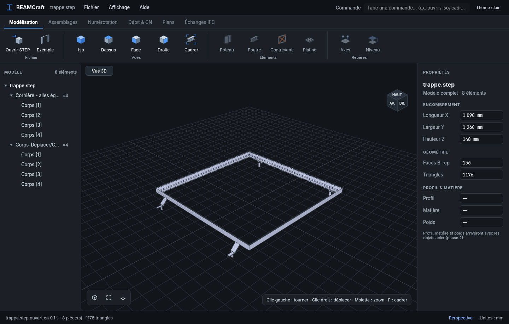

# BEAMCraft

Logiciel **open source de CAO / BIM pour la charpente métallique**, écrit en Rust.
Premier module d'un projet plus large de CAO tout-en-un (paramétrique, BIM, architecture, 2D).



## Où en est-on ?

| Phase | Contenu | État |
|---|---|---|
| **0** | Fenêtre 3D, navigation, ouverture de fichiers STEP, noms des corps, interface de la maquette | ✅ |
| 1 | Esquisse 2D contrainte + extrusion | à venir |
| 2 | Profils acier, débit, export DSTV | à venir |
| 3 | Mise en plan : vues, cotes, DXF/PDF | à venir |
| 4+ | IFC, architecture, modélisation directe | à venir |

## Installer et lancer (macOS)

À faire **une seule fois** :

```bash
# 1. Outils de compilation d'Apple (une fenêtre s'ouvre : cliquer « Installer »)
xcode-select --install

# 2. Rust (répondre « 1 » pour l'installation standard), puis rouvrir le Terminal
curl --proto '=https' --tlsv1.2 -sSf https://sh.rustup.rs | sh
```

Puis, dans le dossier du projet :

```bash
cargo run --release                                  # lance BEAMCraft
cargo run --release -- exemples/ipe300_L1000.step    # ouvre directement un fichier
cargo run --release -- --exemple                     # ouvre le portique d'exemple
```

La **première compilation** prend plusieurs minutes : elle télécharge le noyau
OpenCASCADE précompilé (~45 Mo) et compile toutes les dépendances. Les suivantes
sont rapides.

## Utilisation

| Action | Souris / clavier |
|---|---|
| Tourner | clic gauche (ou molette appuyée) + glisser |
| Déplacer | clic droit + glisser, ou Maj + glisser |
| Zoomer | molette |
| Cadrer tout | `F` ou double-clic |
| Ouvrir un STEP | `Cmd + O`, bouton « Ouvrir STEP » ou glisser-déposer le fichier |
| Orienter la vue | cliquer une face du cube de vue, ou les boutons Iso / Dessus / Face / Droite |
| Masquer une pièce | l'œil à droite de la ligne dans l'arborescence |
| Barre de commande | `ouvrir`, `exemple`, `iso`, `dessus`, `face`, `droite`, `cadrer`, `ortho`, `thème`, `tout` |

Pour démarrer en thème clair : `BEAMCRAFT_THEME=clair cargo run --release`

## Organisation du code

```
crates/
  bc-kernel/   Noyau géométrique : lecture STEP, maillage (OpenCASCADE via `cadrum`)
  bc-viewer/   Vue 3D : rendu wgpu hors écran, caméra orbitale Z en haut, grille
  beamcraft/   L'application (interface egui) : arborescence, vue, propriétés
exemples/      Fichiers STEP de test
```

Règle d'or : **seul `bc-kernel` parle au noyau géométrique**. Si on change de noyau
un jour, rien d'autre n'est à réécrire.

## Commandes utiles pour développer

```bash
cargo test                                            # lance les tests
cargo run -p bc-viewer --example snapshot -- capture.png   # capture de la vue 3D sans fenêtre
cargo run -p bc-kernel --example noms -- fichier.step  # liste les corps d'un STEP
cargo fmt                                             # remet le code en forme
```

## Licences

Polices intégrées : Inter et JetBrains Mono (SIL Open Font License, voir `crates/beamcraft/assets/fonts`).


Code BEAMCraft : MIT ou Apache-2.0, au choix.
Le noyau OpenCASCADE (inclus via `cadrum`) est sous licence LGPL-2.1 avec exception.
